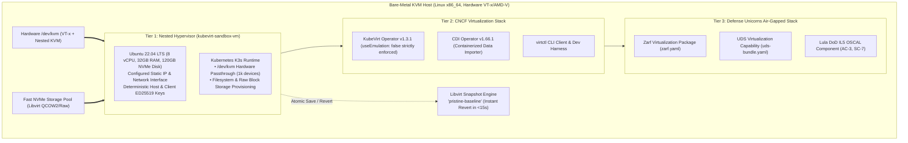

# Cloud-Native Virtualization Dev & Test Platform (`kubevirt-dev-platform`)

[](#)
[](https://github.com/kubevirt/kubevirt)
[](https://github.com/kubevirt/containerized-data-importer)
[](https://defenseunicorns.com)
[](#)
[](https://github.com/defenseunicorns/lula)

A dedicated, reproducible, and snapshot-capable cloud-native virtualization development and testing platform running on a bare-metal KVM host.

Engineered specifically to:
1. **Contribute to CNCF Virtualization Projects:** Test and validate custom Go builds of `virtctl`, `kubevirt/containerized-data-importer` (CDI), and `kubevirt/kubevirt` against hardware nested KVM (`/dev/kvm`).
2. **Showcase Defense Unicorns UDS VM Capabilities:** Author, package, and compliance-validate an air-gapped `uds-package-kubevirt` using Zarf, UDS, and Lula OSCAL IL5 policies matching the **Senior Software Engineer - Virtual Machines (RD222)** role.
3. **Instant Pristine Rollback:** Provide sub-15s baseline restoration via Libvirt atomic snapshots (`virsh snapshot-create-as` / `virsh snapshot-revert`), enabling rapid destructive testing without rebuilding the cluster.

---

## Architecture Overview



---

## Architectural Decision Records (ADRs)

Key architectural and security decisions are formally documented:
- [ADR 0001: Dedicated Nested Hypervisor on Bare-Metal NVMe](docs/adr/0001-dedicated-nested-hypervisor-on-bare-metal-nvme.md)
- [ADR 0002: Deterministic SSH Key Architecture and Strict Host Verification](docs/adr/0002-deterministic-ssh-and-strict-host-verification.md)
- [ADR 0003: Substrate Network Routing and Air-Gapped Workload Delivery Model](docs/adr/0003-network-routing-and-disconnected-delivery-model.md)
- [ADR 0004: Instant Pristine Baseline Snapshots for Destructive Testing](docs/adr/0004-instant-baseline-snapshots-for-destructive-testing.md)

---

## Upstream & Showcase Documentation

- **[CNCF Upstream Contribution Plan](docs/cncf-contribution-plan.md):** Target issues in `kubevirt/kubevirt` and `kubevirt/containerized-data-importer`, developer inner loops for `virtctl` and `cdi-importer`, and community guidelines.
- **[Defense Unicorns UDS VM Showcase](docs/defense-unicorns-uds-vm-showcase.md):** Mapping platform architecture to the Senior Software Engineer - Virtual Machines role, air-gapped packaging with Zarf, and continuous compliance with Lula OSCAL.

---

## Security & Deterministic SSH Architecture

Unlike ephemeral setups that disable SSH host key checking (`StrictHostKeyChecking=no`), this platform enforces **cryptographically deterministic SSH**:
* **Deterministic Host Key:** Generated by `scripts/keygen.sh` and injected into `/etc/ssh/ssh_host_ed25519_key` during cloud-init.
* **Deterministic Client Key:** Created in `substrate/keys/id_kubevirt_dev_ed25519` and injected into `authorized_keys`.
* **Deterministic `known_hosts`:** Pre-seeded for the configured VM IP address and hostname `kubevirt-sandbox-vm`.
* **Strict Verification:** All connections via `make ssh` or automation scripts use `-F .ssh/config` with `StrictHostKeyChecking yes` and `CheckHostIP yes`.

---

## Quickstart

### 1. Initialize Deterministic Keys & Substrate
```bash
# Generate deterministic client and host keys
make keygen

# Run OpenTofu plan against target hypervisor
make plan

# Provision kubevirt-sandbox-vm (8 vCPUs, 32GB RAM, 120GB NVMe disk)
make apply
```

### 2. Connect via Strict Verified SSH
```bash
make ssh
```

### 3. Deploy Kubernetes & Virtualization Stack
```bash
# Installs K3s, KubeVirt Operator v1.3.1, CDI Operator v1.66.1, virtctl, and retrieves kubeconfig
make install-virt
```

### 4. Direct Workstation Access
The cluster `kubeconfig` is automatically fetched to the repository root:
```bash
export KUBECONFIG=./kubeconfig

# View cluster nodes
kubectl get nodes -o wide

# Verify hardware nested KVM devices
kubectl get node kubevirt-sandbox-vm -o jsonpath='{.status.allocatable}'
```

### 5. Run Live End-to-End Verification
```bash
# Launches an official CirrOS containerdisk VMI, verifies virtctl/KVM execution, and tears down
make test-e2e
```

### 6. Capture or Revert Pristine Baseline Snapshot
```bash
# Capture atomic baseline snapshot
make snapshot-pristine

# View snapshots
make snapshot-list

# Revert dirty or broken cluster state back to pristine baseline in seconds:
make restore-pristine
```

---

## Directory Structure

```
kubevirt-dev-platform/
├── .github/
│   ├── pull_request_template.md    # PR template with DoD IL5 & CNCF verification gates
│   └── workflows/
│       └── ci.yml                  # GitHub Actions CI: Gitleaks, ShellCheck, OpenTofu, YAML
├── .gitleaks.toml                  # Secret scanning configuration
├── docs/
│   ├── adr/                        # Architecture Decision Records
│   │   ├── 0001-dedicated-nested-hypervisor-on-bare-metal-nvme.md
│   │   ├── 0002-deterministic-ssh-and-strict-host-verification.md
│   │   ├── 0003-network-routing-and-disconnected-delivery-model.md
│   │   └── 0004-instant-baseline-snapshots-for-destructive-testing.md
│   ├── cncf-contribution-plan.md   # Roadmap for KubeVirt & CDI upstream contributions
│   └── defense-unicorns-uds-vm-showcase.md # Alignment with UDS VM mission
├── Makefile                        # Top-level orchestration driver
├── substrate/                      # OpenTofu infrastructure definition
│   ├── main.tf                     # Libvirt domain with host-passthrough & NVMe storage
│   ├── variables.tf                # Configurable VM sizing and networking
│   ├── outputs.tf                  # Generated connection strings
│   ├── keys/                       # Deterministic ED25519 keypairs (.gitignore filtered)
│   └── templates/
│       ├── cloud_init.cfg          # Cloud-init with deterministic host keys and KVM setup
│       └── network_config.cfg      # Configurable static IP template
├── scripts/
│   ├── keygen.sh                   # Deterministic SSH keypair and known_hosts generator
│   ├── snapshot_manager.sh         # Libvirt snapshot create/revert/list automation
│   └── install_k8s_virt.sh         # K3s, KubeVirt, CDI, and virtctl deployment engine
├── manifests/
│   ├── kubevirt-cr.yaml            # KubeVirt CR (hardware KVM enforced, useEmulation: false)
│   └── cdi-cr.yaml                 # CDI CR with upload proxy and DataVolume config
├── zarf/                           # Defense Unicorns Showcase
│   ├── zarf.yaml                   # Air-gapped package definition for KubeVirt & CDI
│   ├── uds-bundle.yaml             # UDS capability bundle definition
│   └── oscal-component.yaml        # Lula DoD IL5 OSCAL compliance component
└── tests/
    ├── test_vmi.yaml               # CirrOS test VirtualMachineInstance
    └── e2e_test.sh                 # End-to-end VMI lifecycle verification
```

---

## Shift-Left Quality & Security Gates

Run the local static analysis suite before opening any pull request:
```bash
make test-static
```
This validates:
- ShellCheck compliance across all shell automation (`scripts/*.sh`, `tests/*.sh`).
- OpenTofu formatting and syntax validation (`tofu fmt -check && tofu validate`).
- YAML schema validity across all manifests, Zarf configs, and cloud-init templates.
- Deterministic SSH key consistency.
